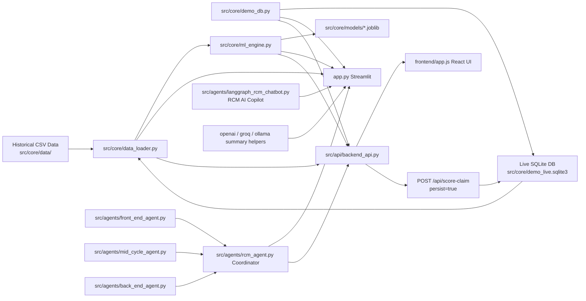
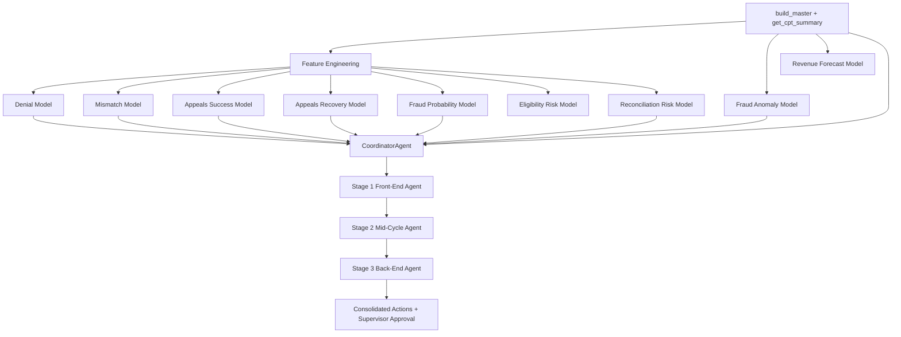
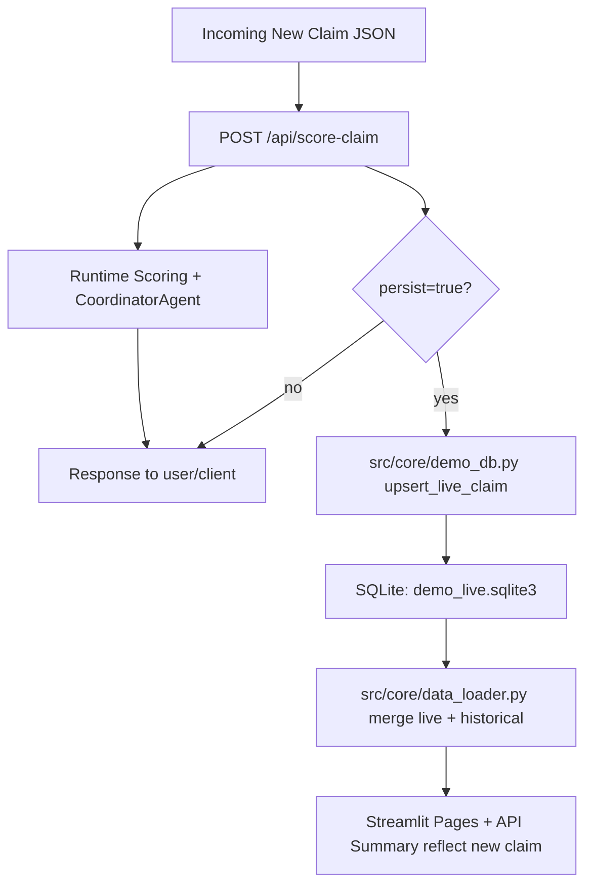

# AI-Powered Smart RCM Prototype

AI-powered Revenue Cycle Management prototype with a Streamlit dashboard, ML models, agentic claim orchestration, an OpenAI-powered RCM AI Copilot (LangGraph; Groq/Ollama optional), and a React demo UI.

## What Is Implemented

- Predictive denial intelligence (`XGBoost` + SHAP explainability)
- Smart claim scrubbing (`CPT-ICD` mismatch risk + recommendations)
- Appeals prioritization (success probability + expected recovery estimate)
- Fraud enhancement (supervised risk + `IsolationForest` anomaly blending)
- Patient access and eligibility risk scoring
- Payment reconciliation risk scoring
- Revenue trend forecasting
- Agentic workflow (`CoordinatorAgent` + Front-End / Mid-Cycle / Back-End agents)
- Claim-level RCM AI Copilot in Streamlit (LangGraph + OpenAI by default)
- 2-page narrative summary helpers (OpenAI / Groq / Ollama)
- Lightweight Python backend API + React (no-build CDN) UI

---

## Repository Components

| Path | Role |
|---|---|
| `app.py` | Main Streamlit Command Center |
| `pages/` | Multipage Streamlit dashboards |
| `utils_ui.py` / `style.css` / `config.py` | Shared UI helpers, theme, LLM config |
| `src/core/data_loader.py` | CSV loading, live-DB merge, feature prep |
| `src/core/demo_db.py` | SQLite persistence for live demo claims |
| `src/core/ml_engine.py` | Model train / load / score pipeline |
| `src/core/data/` | Historical synthetic CSV datasets |
| `src/core/models/` | Trained `.joblib` artifacts (created on train) |
| `src/agents/rcm_agent.py` | `CoordinatorAgent` + legacy specialist agents |
| `src/agents/front_end_agent.py` | Stage 1 patient access / eligibility / scrubbing |
| `src/agents/mid_cycle_agent.py` | Stage 2 coding / documentation validation |
| `src/agents/back_end_agent.py` | Stage 3 denials / appeals / fraud / reconciliation |
| `src/agents/langgraph_rcm_chatbot.py` | LangGraph RCM AI Copilot (OpenAI / Groq / Ollama) |
| `src/agents/custom_coding_agent.py` | CPT → ICD coding recommendations |
| `src/agents/clinical_nlp_agent.py` | Clinical note → ICD prediction |
| `src/agents/openai_agent_summary.py` | OpenAI 2-page summary generation |
| `src/agents/groq_agent_summary.py` | Groq 2-page summary generation |
| `src/agents/ollama_agent_summary.py` | Ollama 2-page summary generation |
| `src/api/backend_api.py` | JSON API for the React dashboard |
| `frontend/` | React dashboard prototype (CDN, no build step) |
| `docs/ARCHITECTURE_ROADMAP.md` | Future cloud / FHIR / AWS roadmap |

---

## Architecture



---

## ML and Agent Flow



## Live Ingestion Flow (Demo DB Mode)



## Three-Stage Alignment

- **Stage 1: Front-End Automation** (`front_end_agent.py`) — eligibility / auth readiness and pre-submission scrubbing
- **Stage 2: Mid-Cycle** (`mid_cycle_agent.py`) — CPT/ICD + NLP coding validation
- **Stage 3: Back-End Efficiency** (`back_end_agent.py`) — appeals letter draft, fraud control, reconciliation
- **Coordinator** (`rcm_agent.py`) — Front-End → Mid-Cycle → Back-End → supervisor approval

---

## Dashboard Pages (Streamlit)

- RCM Command Center
- Patient Access & Eligibility
- Smart Scrubbing
- AI Denial Predictor
- Denial Intelligence
- Appeals Analytics
- Payment Reconciliation
- AR Aging & Lifecycle
- Fraud Detection
- Revenue Forecasting
- Monitoring & Alerts
- Agentic RCM Agent
- RCM AI Copilot (LangGraph + OpenAI)

Sidebar is grouped by operational stage: Command → Front-End → Mid-Cycle → Back-End → Intelligence & Ops.

**Suggested demo path:** Command Center → AI Denial Predictor → Fraud / Scrubbing → **RCM AI Copilot**.

---

## Setup

### 1) Create environment and install dependencies

Python **3.10+** recommended (pinned `numpy==2.2.4`).

```bash
python3 -m venv venv
source venv/bin/activate
pip install -r requirements.txt
```

If `venv/bin/streamlit` has a broken shebang (copied venv), always use:

```bash
./venv/bin/python -m streamlit run app.py
```

### 2) Configure environment variables

Copy the example file and add your key:

```bash
cp .env.example .env
```

`.env` contents:

```env
# OpenAI (default provider)
OPENAI_API_KEY=sk-...
OPENAI_MODEL=gpt-4o-mini
DEFAULT_LLM=openai

# Groq (optional)
GROQ_API_KEY=
GROQ_MODEL=llama-3.3-70b-versatile

# Ollama (optional)
OLLAMA_MODEL=llama3:8b
```

`config.py` loads this via `python-dotenv`. Supported `DEFAULT_LLM` values: `openai`, `groq`, `ollama`.

Never commit `.env` (it is gitignored).

---

## Run the System

### Option A: Main Streamlit application (recommended)

```bash
source venv/bin/activate
./venv/bin/python -m streamlit run app.py
```

Open **http://127.0.0.1:8501** (prefer `127.0.0.1` over `localhost` if the page fails to load).

### Option B: React demo UI with backend API

```bash
# Terminal 1 — API (from repo root)
source venv/bin/activate
./venv/bin/python -m src.api.backend_api

# Terminal 2 — static frontend
cd frontend
python3 -m http.server 8080
```

Open `http://localhost:8080`. Root `index.html` redirects to `frontend/index.html` if served from the project root.

### Option C: Docker

```bash
# Requires a .env file in the project root
docker compose up --build
```

Serves Streamlit on port `8501`.

---

## Models

- Artifacts are stored under **`src/core/models/`** (not the legacy root `models/` folder).
- If a model file is missing, training runs automatically on first use (can take a few minutes on 50k claims).
- To pre-train before a demo, open model-heavy pages once, or run a short training script that calls `ml_engine.train_*` / `fit_revenue_forecast_model`.

---

## API Endpoints

From `src/api/backend_api.py` (base URL `http://localhost:8001`):

| Method | Path | Purpose |
|---|---|---|
| `GET` | `/api/health` | Health check |
| `GET` | `/api/summary` | Dashboard KPIs for React UI |
| `GET` | `/api/agent/claim/<claim_id>` | Score claim + run Coordinator |
| `POST` | `/api/score-claim` | Realtime single-claim inference |

### Realtime single-claim inference

Use `POST /api/score-claim` to score a new claim and run `CoordinatorAgent`.
Set `"persist": true` to store the claim in demo SQLite so it can appear in later dataset loads.

```bash
curl -X POST "http://localhost:8001/api/score-claim" \
  -H "Content-Type: application/json" \
  -d '{
    "claim_id": 990001,
    "encounter_id": 880001,
    "patient_id": 770001,
    "insurance": "Aetna",
    "visit_type": "OP",
    "icd_code": "E11.9",
    "gender": "F",
    "age": 54,
    "claim_amount": 1850,
    "paid_amount": 0,
    "fraud_score": 0.32,
    "denial_reason": "Auth required",
    "is_denied": true,
    "is_appealed": false,
    "appeal_success": false,
    "cpt_codes": ["99213", "80053"],
    "total_cpt_amount": 1750,
    "clinical_notes": "Diabetes follow-up, lab review, medication adjustment.",
    "persist": true
  }'
```

Note: after persisting via the API, restart Streamlit (or clear its cache) if the new claim does not appear immediately in the dashboard.

---

## LLM / Copilot

RCM AI Copilot and Patient Access chat use `DEFAULT_LLM` (**default: OpenAI**).

| Provider | Required setup |
|---|---|
| **OpenAI** (default) | `OPENAI_API_KEY`, optional `OPENAI_MODEL` (default `gpt-4o-mini`) |
| **Groq** | `DEFAULT_LLM=groq` + `GROQ_API_KEY` |
| **Ollama** | `DEFAULT_LLM=ollama` + local `ollama serve` |

Summary helpers:

- `src/agents/openai_agent_summary.py`
- `src/agents/groq_agent_summary.py`
- `src/agents/ollama_agent_summary.py`

---

## Notes

- Prototype focused on demoability and extensibility; data is synthetic.
- Future production direction (FHIR, AWS, Bedrock, SageMaker) is documented in [`docs/ARCHITECTURE_ROADMAP.md`](docs/ARCHITECTURE_ROADMAP.md).
